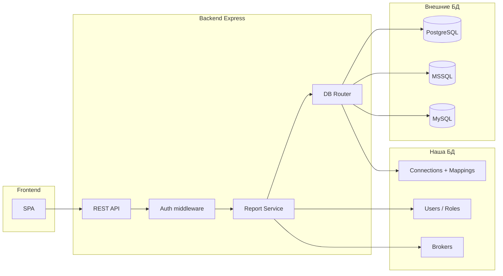
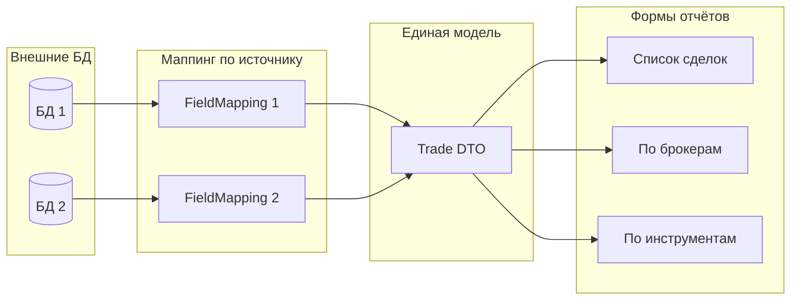

# План: система отчетности по сделкам (multi-DB, роли, только отчёты)

## Цели и ограничения

- **Строгое правило (внешние БД торговой системы):** к этим базам выполняются **только SELECT**-запросы. Запрещены INSERT, UPDATE, DELETE, CREATE, ALTER, DROP и любые запросы, меняющие структуру или данные — там боевые данные. В коде и при настройке подключений использовать только чтение (read-only пользователь БД и/или проверка типа запроса в слое доступа).
- **Только чтение**: данные только из существующих БД торговой системы, без создания/изменения таблиц сделок.
- **Несколько БД**: подключение к разным СУБД (PostgreSQL, MSSQL, MySQL и т.д.) с разной структурой таблиц.
- **Роли**: администратор, брокер, сотрудник биржи; разграничение доступа к отчётам.
- **Веб-интерфейс**: дашборды, таблицы сделок, экспорт (Excel/CSV).

---

## Архитектура




- **Одна своя БД** (например SQLite или PostgreSQL): пользователи, роли, справочник брокеров, настройки подключений к внешним БД и маппинг полей. Модели создаём только для этой БД.
- **Внешние БД**: без миграций и моделей; доступ только на чтение через драйверы (`pg`, `mssql`, `mysql2`) и единый слой с маппингом.

---

## 1. Стек и структура проекта

- **Backend**: Node.js, Express, TypeScript.
- **Своя БД**: SQLite (или PostgreSQL) + TypeORM/Prisma/Sequelize — только для пользователей, ролей, брокеров и конфигурации подключений.
- **Внешние БД**: драйверы `pg`, `mssql`, `mysql2`; пул соединений и фасад с маппингом (таблица + поля → единая DTO «сделка»).
- **Frontend**: React (или Vue) + TypeScript, сборка (Vite). Таблицы и графики — TanStack Table + простая библиотека графиков (Chart.js или Recharts). Экспорт — xlsx, csv на бэкенде или фронте.

**Примерная структура реализации проекта** (формы отчётов все разные — описываются в БД через ReportForm, а не отдельным кодом на каждую форму; один движок интерпретирует любую форму):

```
quik_reports_v2/
├── package.json
├── tsconfig.json
├── .env.example
│
├── server/
│   ├── index.ts                    # точка входа, поднятие Express и пулов БД
│   ├── app.ts                      # Express app, middleware, маршруты
│   │
│   ├── config/
│   │   └── index.ts                # конфиг приложения, порт, своя БД
│   │
│   ├── db/                         # только наша БД (миграции, модели)
│   │   ├── index.ts                # инициализация ORM, подключение
│   │   ├── entities/
│   │   │   ├── User.ts
│   │   │   ├── Broker.ts
│   │   │   ├── DataSource.ts
│   │   │   ├── FieldMapping.ts
│   │   │   ├── ReportForm.ts
│   │   │   └── CurrencyRate.ts
│   │   └── migrations/            # миграции только для нашей БД
│   │
│   ├── jobs/                      # фоновые задания (только запись в нашу БД)
│   │   ├── index.ts               # запуск планировщика при старте
│   │   └── currency-rates.ts      # обновление курсов каждые 1–5 мин (интервал в конфиге)
│   │
│   ├── data-sources/               # работа с внешними БД — только SELECT
│   │   ├── index.ts                # фасад: getTrades(dataSourceId, filters)
│   │   ├── pool-manager.ts         # пулы по типу БД (pg, mssql, mysql2)
│   │   ├── build-select.ts        # построение только SELECT по FieldMapping
│   │   ├── postgres.ts
│   │   ├── mssql.ts
│   │   └── mysql.ts
│   │
│   ├── reports/                    # движок отчётов (все формы — через конфиг)
│   │   ├── report-engine.ts        # run(formId, dataSourceIds, filters) → данные
│   │   ├── runners/                # как выполнить по типу формы (одна форма = один тип)
│   │   │   ├── table-runner.ts     # type=table: выбор полей, фильтр, пагинация
│   │   │   ├── summary-runner.ts   # type=summary: groupBy + aggregates
│   │   │   └── chart-runner.ts     # type=chart: те же агрегаты, формат для графика
│   │   ├── export/
│   │   │   ├── xlsx.ts
│   │   │   └── csv.ts
│   │   └── filters.ts              # применение фильтров к данным (дата, брокер, и т.д.)
│   │
│   ├── auth/
│   │   ├── middleware.ts           # JWT, проверка роли и brokerId
│   │   ├── service.ts              # login, hash, проверка прав на отчёты
│   │   └── types.ts
│   │
│   ├── routes/
│   │   ├── index.ts                # сводный router
│   │   ├── auth.routes.ts
│   │   ├── currency-rates.routes.ts # GET актуальные курсы
│   │   ├── report-forms.routes.ts  # GET список форм, GET :id метаданные
│   │   ├── reports.routes.ts       # POST run, GET/POST export
│   │   ├── data-sources.routes.ts  # admin CRUD (наша БД)
│   │   ├── brokers.routes.ts
│   │   └── users.routes.ts
│   │
│   └── types/
│       └── index.ts                # Trade (канонический), ReportFormDto, RunParams
│
├── client/
│   ├── index.html
│   ├── vite.config.ts
│   ├── src/
│   │   ├── main.tsx
│   │   ├── App.tsx
│   │   ├── api/                    # вызовы бэкенда
│   │   │   ├── auth.ts
│   │   │   ├── report-forms.ts
│   │   │   └── reports.ts
│   │   ├── pages/
│   │   │   ├── Login.tsx
│   │   │   ├── Dashboard.tsx
│   │   │   ├── Reports.tsx         # список форм → выбор формы → фильтры → результат
│   │   │   └── admin/
│   │   │       ├── DataSources.tsx
│   │   │       ├── FieldMapping.tsx
│   │   │       ├── ReportForms.tsx  # CRUD форм (поля, groupBy, aggregates, chart)
│   │   │       ├── Brokers.tsx
│   │   │       └── Users.tsx
│   │   ├── components/
│   │   │   ├── ReportFilters.tsx   # общий блок фильтров (даты, брокер, источники)
│   │   │   ├── ReportTable.tsx     # отображение результата type=table
│   │   │   ├── ReportSummary.tsx   # отображение type=summary
│   │   │   ├── ReportChart.tsx     # отображение type=chart (Chart.js/Recharts)
│   │   │   └── ExportButtons.tsx
│   │   ├── store/                  # при необходимости (auth, выбранная форма)
│   │   └── types/
│   │
│   └── package.json
│
└── shared/                         # общие типы (опционально, можно дублировать в server/types)
    └── types.ts                    # Trade, ReportFormType, ColumnDef, Aggregation
```

**Как отражается то, что формы отчётов все разные:**

- Нет папки «по одной папке на каждый отчёт»: каждая форма — это запись в таблице **ReportForm** (name, type, columns, groupBy, aggregates, chartConfig и т.д.).
- Один и тот же код обрабатывает все формы:
  - **report-engine.ts** по `formId` загружает форму из БД, подставляет в нужный runner по `form.type` (table | summary | chart).
  - **table-runner** — для форм «просто таблица с колонками»; **summary-runner** — для форм «сводка по полям + агрегаты»; **chart-runner** — для форм «график» (те же данные, другой формат ответа).
- Различия между формами задаются только конфигом (поля в ReportForm): какие columns, по чему groupBy, какие aggregates, тип графика. Добавление нового вида отчёта = новая запись ReportForm (админка или сидер), без новых файлов в `reports/runners/`.
- На фронте один слой отображения на тип: **ReportTable** / **ReportSummary** / **ReportChart** получают данные и метаданные формы (columns, labels) и рендерят соответственно; список форм приходит с API и может быть любым.

---

## 2. Своя БД: сущности (только здесь создаём модели)

- **User**: id, login, passwordHash, role (enum: admin | broker | exchange), brokerId (nullable, FK на Brokers), displayName, createdAt.
- **Broker**: id, name, code (опционально). Справочник брокеров; у брокера и сотрудника биржи может быть привязка.
- **Role**: можно зашить в enum (admin, broker, exchange_employee); при необходимости позже вынести в таблицу Role.
- **DataSource** (подключение к внешней БД): id, name, type (postgres | mssql | mysql), connectionConfig (JSON: host, port, user, password, database), isActive, createdAt.
- **FieldMapping**: id, dataSourceId (FK), tableName, columnMappings (JSON: `{ "trade_id": "id", "broker_id": "broker_code", "amount": "sum", "deal_time": "created_at", ... }`). Таким образом под каждую БД задаётся своя таблица и маппинг полей в единую схему «сделка».
- **ReportForm**: id, name, code, description, type (table | summary | chart), columns (JSON), groupBy (JSON), aggregates (JSON), filters (JSON), chartConfig (JSON), requiredFields (JSON). Описание одного вида отчёта; движок интерпретирует его поверх нормализованных данных.
- **CurrencyRate**: id, currencyCode (например USD), rate (число, курс к базовой валюте), baseCurrency (например RUB — к чему приведён курс), updatedAt. Список курсов валют в нашей БД; изначально — USD, при необходимости добавляются другие коды. Обновляется фоновым заданием, не из внешних торговых БД.

**Курсы валют (обновление каждые 1–5 минут):**

- Хранятся только в **нашей** БД; запись (INSERT/UPDATE) — только в таблицу CurrencyRate, внешние торговые БД не трогаем.
- Источник курсов — внешний API (например ЦБ РФ, ECB или иной), запрос из приложения по расписанию; парсинг ответа и сохранение в CurrencyRate.
- Интервал обновления: **каждые 1–5 минут** (задать в конфиге, например `CURRENCY_UPDATE_INTERVAL_MS=60000` или 300000). Планировщик (setInterval или node-cron) в `server/jobs/currency-rates.ts` по таймеру вызывает загрузку курсов и запись в нашу БД.
- Изначально в списке — **USD**; при необходимости в конфиге или в справочнике задаётся перечень кодов валют (USD, EUR, …), по которым запрашивать курс.
- API для отчётов/интерфейса: `GET /api/currency-rates` — отдать актуальные курсы из нашей БД (SELECT), чтобы при необходимости пересчитывать суммы в отчётах в базовую валюту.

Единая схема «сделка» (в коде), к которой приводим маппинг:

- id (или внешний ключ), brokerId/brokerCode, instrument, amount, price, dealTime, side (buy/sell), и другие поля по необходимости — фиксированный набор полей в DTO.

---

## 2.1 Много видов (форм) отчётов при разных структурах БД

**Идея:** структуры источников различаются (маппинг на источник), а **формы отчётов** задаются в нашей системе и работают поверх **единой нормализованной модели**. Один и тот же отчёт можно запускать по разным БД — данные сначала приводятся к каноническим полям, затем применяется описание формы.




**Сущность ReportForm (форма отчёта)** — хранится в нашей БД, описывает «что показывать и как», без привязки к конкретной БД:

- **id, name, code, description** — название и идентификатор формы.
- **type**: `table` | `summary` | `chart` — тип вывода (таблица, сводная таблица, график).
- **columns** (JSON): список полей из канонической модели для отображения: `[{ field: "brokerCode", label: "Брокер", format?: "string" }, ...]`. Для таблицы — колонки; для summary/chart — поля группировки и агрегатов.
- **groupBy** (JSON, опционально): по каким полям группировать, например `["brokerId", "dealDate"]` — для сводок и графиков.
- **aggregates** (JSON, опционально): агрегаты по полям, например `[{ field: "amount", op: "sum", label: "Объём" }, { field: "id", op: "count", label: "Кол-во сделок" }]`.
- **filters** (JSON): какие фильтры доступны у этой формы (даты, брокер, инструмент, источник данных) — совпадает с общим пулом фильтров, форма только перечисляет, какие из них показывать.
- **chartConfig** (JSON, опционально): для type=chart — тип графика (bar, line, pie), ось X, серии.
- **requiredFields** (JSON, опционально): список канонических полей, без которых отчёт не имеет смысла. При запуске по источнику можно проверять, что в FieldMapping есть все эти поля; иначе — не показывать источник в выборе или выводить предупреждение.

**Как это реализует «много форм» при разных структурах:**

1. У каждой внешней БД — свой **FieldMapping**: свои имена таблиц/полей → одни и те же канонические имена (brokerId, instrument, amount, dealTime и т.д.).
2. Формы отчётов опираются **только на канонические поля**. Несколько десятков форм — это просто разные записи ReportForm с разными column/groupBy/aggregates/chartConfig.
3. При запуске отчёта: выбираются источники (и при необходимости фильтр по ролям) → из каждого источника читаются данные и приводятся к Trade DTO → объединяем (с пометкой источника) → применяем выбранную форму: срез полей, группировка, агрегаты, пагинация.
4. Добавление нового «вида» отчёта = новая запись ReportForm (через админку или миграцию/сидер), без правок кода движка отчётов.

**Движок отчётов (ReportEngine):**

- Вход: reportFormId, dataSourceIds[], значения фильтров (даты, брокер и т.д.), пагинация.
- Загружает ReportForm по id; для каждого выбранного источника загружает данные в каноническом виде (существующий слой маппинга); при необходимости проверяет requiredFields по маппингу источника.
- В зависимости от form.type:
  - **table**: выборка полей из columns, фильтрация, сортировка, пагинация (в памяти или через запрос, если одна БД).
  - **summary**: groupBy + aggregates по объединённому набору записей (в памяти или один запрос с GROUP BY на источник, если один источник).
  - **chart**: те же группировка и агрегаты, отдача данных в формате для графика (labels + series).
- Один и тот же движок обслуживает все формы; различие только в конфиге формы.

**API для форм:**

- `GET /api/report-forms` — список доступных пользователю форм (с учётом ролей).
- `GET /api/report-forms/:id` — метаданные формы (поля, фильтры, тип).
- `POST /api/reports/run` — тело: `{ reportFormId, dataSourceIds?, filters: { dateFrom, dateTo, brokerId, ... }, page?, limit? }`; ответ — данные в формате, соответствующем типу формы (rows для table, grouped rows для summary, chart data для chart).
- `GET /api/reports/export` — тот же reportFormId + фильтры + format (xlsx/csv); движок формирует выборку по форме и отдаёт файл.

**Админка:** CRUD для ReportForm — создание/редактирование форм (поля, группировки, агрегаты, тип графика) без программирования. Так можно наращивать «очень много видов отчётов» за счёт конфигурации.

---

## 3. Подключение к нескольким базам и маппинг

- **Инициализация**: при старте приложения по списку DataSource с isActive=true создаются пулы соединений (по одному на тип СУБД).
- **Запрос данных**: ReportService принимает фильтры (дата, брокер, инструмент, выбранные dataSourceIds). Для каждого выбранного (или всех разрешённых) источника:
  - по FieldMapping строится **только** SQL SELECT (внешние имена полей → алиасы под единые имена); никаких INSERT/UPDATE/DELETE и DDL;
  - запрос выполняется через соответствующий драйвер;
  - строки приводятся к общему формату Trade[].
- Объединение: результаты по нескольким БД можно объединять в один список (с пометкой sourceId/sourceName) и отдавать в API. Пагинация — на уровне приложения (slice после сбора) или по возможности на уровне SQL для одной БД.

Важно: пароли и строки подключения хранить в зашифрованном виде или в секретах; в конфиге только ссылка или идентификатор.

---

## 4. Роли и разграничение доступа

- **Admin**: полный доступ — управление пользователями, ролями, справочником брокеров, настройка DataSource и FieldMapping; просмотр всех отчётов по всем БД.
- **Broker**: доступ только к отчётам по сделкам своего брокера (фильтр по brokerId из User). Видит только те DataSource, к которым ему явно открыт доступ (если введём связь User/Role — DataSource, иначе по умолчанию «все активные», но фильтр по брокеру обязателен).
- **Exchange employee**: доступ к отчётам в более широком объёме (например все брокеры или по списку бирж). Имеет смысл завести поле в User (например allowedBrokerIds JSON или связь с биржами) и в отчётах применять соответствующий фильтр.

Авторизация: простая схема «логин + пароль», JWT в cookie или Authorization header. Middleware проверяет роль и brokerId и накладывает ограничения на параметры запросов отчётов (фильтр по broker_id, по списку источников и т.д.).

---

## 5. API (эскиз)

- `POST /api/auth/login`, `POST /api/auth/logout`, `GET /api/auth/me` — авторизация и текущий пользователь (роль, brokerId, права).
- **Курсы валют:** `GET /api/currency-rates` — актуальные курсы из нашей БД (для отчётов и пересчёта в базовую валюту).
- **Формы отчётов:** `GET /api/report-forms` — список форм; `GET /api/report-forms/:id` — метаданные формы (поля, фильтры, тип).
- **Выполнение отчёта:** `POST /api/reports/run` — тело: `reportFormId`, `dataSourceIds[]`, `filters` (dateFrom, dateTo, brokerId, instrument…), `page`, `limit`. Ответ зависит от типа формы: строки таблицы, сгруппированные данные или данные для графика.
- **Экспорт:** `GET /api/reports/export` или `POST` с телом — `reportFormId`, фильтры, format (xlsx|csv). Движок строит выборку по форме и отдаёт файл.
- Для дашборда можно оставить отдельный endpoint агрегатов или одну из форм типа summary/chart.
- Admin-only:
  - CRUD `/api/data-sources`, `/api/data-sources/:id/mapping`.
  - CRUD `/api/brokers`, CRUD `/api/report-forms` (управление формами отчётов).
  - CRUD `/api/users` (с указанием роли и brokerId).

---

## 6. Frontend (кратко)

- Страница входа; после логина — переход на дашборд или список отчётов.
- Дашборд: блоки/графики по выбранному периоду и (при необходимости) по выбранным источникам/брокерам — объёмы, количество сделок, топ инструментов.
- **Отчёты:** выбор формы отчёта из списка (например «Список сделок», «По брокерам», «По инструментам», «График объёма по дням»); общие фильтры (даты, брокер, инструмент, источники); отображение результата в виде таблицы, сводки или графика; кнопки «Экспорт Excel/CSV» с учётом выбранной формы.
- Админ-разделы: управление подключениями к БД и маппингом полей; **управление формами отчётов** (создание/редактирование: поля, группировка, агрегаты, тип графика); справочник брокеров; пользователи и роли.
- Рендер пунктов меню и доступ к разделам в зависимости от роли (admin / broker / exchange_employee).

---

## 7. Безопасность и надёжность

- **Внешние БД (боевые данные):** разрешены только SELECT-запросы. В коде слой доступа к внешним БД не должен формировать и выполнять INSERT/UPDATE/DELETE/CREATE/ALTER/DROP и т.п.; при настройке подключений использовать учётную запись с правами только на чтение (read-only). Это жёсткое требование, не рекомендация.
- Учётные данные внешних БД не логировать.
- Валидация и санитизация параметров (даты, id, имена таблиц/полей из маппинга — белый список) во избежание SQL-инъекций при сборке запросов.
- Ограничение числа одновременных тяжёлых отчётов и таймауты на запросы к внешним БД, чтобы один источник не блокировал приложение.

---

## 8. Этапы реализации (рекомендуемый порядок)

1. **Каркас**: Express + TypeScript, своя БД (SQLite/Postgres), модели User, Broker, DataSource, FieldMapping; миграции/сидеры.
2. **Подключение к внешним БД**: слой `data-sources` с маппингом, один тип (например PostgreSQL), один тестовый источник и один маппинг; одна базовая форма отчёта (например «Список сделок»); endpoint `POST /api/reports/run` без ролей.
3. **Авторизация и роли**: логин/пароль, JWT, middleware, проверка прав и фильтрация по brokerId/роли в запросах отчётов.
4. **Поддержка нескольких типов СУБД**: добавление MSSQL и MySQL в DataSource и в фасад; тест с разными маппингами.
5. **Движок форм отчётов**: полная поддержка type table/summary/chart, groupBy и aggregates; проверка requiredFields по маппингу.
6. **Дашборд**: одна или несколько форм типа summary/chart как виджеты; общие фильтры.
7. **Экспорт**: генерация XLSX/CSV по выбранной форме и фильтрам.
8. **Frontend**: страницы логина, дашборда, выбора и просмотра отчётов по формам, экспорт; админ-страницы для источников, маппинга, **форм отчётов**, брокеров, пользователей.
9. **Уточнение прав сотрудника биржи**: при необходимости — отдельная сущность «биржа» и привязка пользователя к списку брокеров/бирж.

После этого система будет читать сделки из нескольких БД с разной структурой, отображать их в едином виде в отчётах и дашборде, разграничивать доступ по ролям и позволять экспортировать данные.